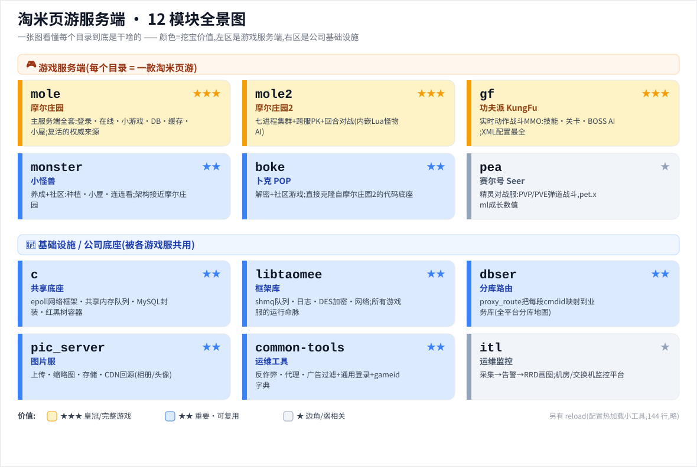
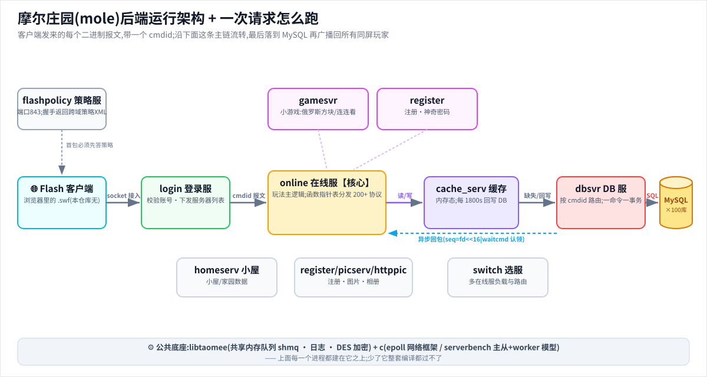
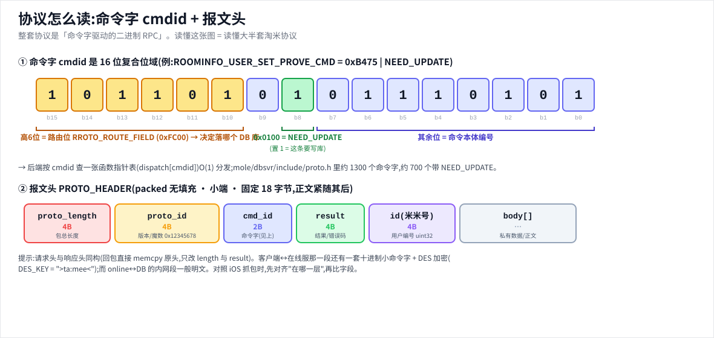
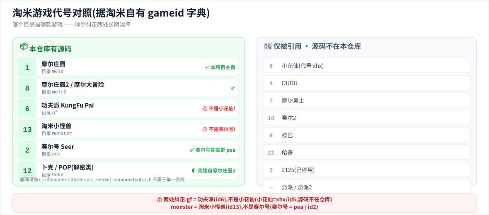

# 淘米(Taomee)页游服务端源码 · 中文挖宝/学习导览

> 这是一份**纯文档层**:在不改动任何源码的前提下,为这份淘米老服务端源码加一层中文地图,方便挖宝、协议比对与学习开发。
> 本项目最终目的:为 **摩尔庄园离线复活**(moleworld-server / MoleWorld-offline)提供参照。
>
> 🆕 **两个新增亮点**:① [**深度档案**](#8-深度档案每个部分实际在干什么) —— 逐模块讲清"每个部分实际在运行时干什么"(进程拓扑、调用流、关键函数);② [**🥚 工程师彩蛋**](docs/easter-eggs.md) —— 从源码里挖到的吐槽、玩笑、TODO、走马灯密码、`fuck_version_check` 之类的人味遗留。

---

## 0. 一句话:这是什么 / 不是什么

**是什么** —— 上海淘米(TaoMee, Inc. ShangHai)2007–2013 年间的**网页 Flash 页游服务端真源码**(C/C++ 为主),含多款游戏服务端 + 一整套公司级基础设施。证据:作者头注 `Author: xcwen, xcwenn@gmail.com` / `jim@taomee.com`、`Company: TaoMee.Inc`;[mole/flashpolicy](mole/flashpolicy) 是 Flash socket 策略服(铁证它服务的是 Flash 网页客户端);[mole/online/changelog](mole/online/changelog) 记录 2008 感恩节摩尔餐厅等版本。

**不是什么**(请勿被误导):
- ❌ **不含任何客户端**(无 `.swf/.fla/.as`,无美术/动画资产)。
- ❌ **不是 iOS 手游版的后端**。这是**网页 Flash 版**后端;手游(cocos2d / 5.x)协议可能已演进,只能**参照对照**,不能假设一致。
- ❌ **不含数据库实际数据**(建表多、游戏侧种子数据几乎为 0,详见 [内容/数据专题](docs/content-data.md))。

**规模** —— 12 个顶层模块 + 2 个框架包,约 **1.1 万个文件 / 近百万行 C/C++** /工作树约 318MB;年代:核心 2007 → 大扩张 2010–2011 → 内容配置延续到 ~2012–2013。

---

## 🗺️ 一图看懂(没接触过的人也能秒懂)

> 四张框架图,点开可看大图。看不清就读文字版:[价值地图](#2-价值地图最终版) · [架构 deep/mole.md](docs/deep/mole.md) · [协议 protocol.md](docs/protocol.md)。

**① 12 模块全景 —— 每个目录到底是干啥的**



**② 摩尔庄园后端运行架构 + 一次请求怎么跑**



**③ 协议怎么读:命令字 cmdid + 报文头**



**④ 游戏代号对照(纠正两处长期误传)**



---

## 1. ⚠ 正本清源:游戏代号对照(已用淘米自有字典核实)

挖宝前先记住"哪个目录是哪款游戏"。**早期口口相传的 baseline 有两处错**,本文档已据淘米**自有的 gameid 字典**与**分库路由表**逐一更正:

- 权威字典:[common-tools/linux/anticheat/trunk/docs/gameid](common-tools/linux/anticheat/trunk/docs/gameid)
- 权威路由:[dbser/proxy_route.h](dbser/proxy_route.h#L29)(`enum_route_type` 把每段 cmdid 映射到一个业务库)

| 目录 | 真实游戏(gameid) | baseline 旧说法 | 结论 |
|---|---|---|---|
| `mole` | **摩尔庄园**(id 1) | 摩尔庄园 | ✅ 正确 |
| `mole2` | **摩尔庄园2 / 摩尔大冒险**(id 8) | 摩尔庄园2 | ✅ 正确 |
| `gf` | **功夫派 KungFu Pai**(id 6) | ~~小花仙~~ | ❌→✅ **更正**:货币"功夫豆"、怪物木人/木王/铜人;小花仙是另一款 `xhx`(id 5),不在本仓库 |
| `monster` | **淘米小怪兽**(id 13) | ~~赛尔号~~ | ❌→✅ **更正**:养成+社区玩法,见 `小怪兽机器部署图.doc`;赛尔号是 `pea` |
| `pea` | **赛尔号 Seer**(id 2) | 赛尔号(+pea) | ✅ 正确(pea 才是赛尔号:`pet.xml` 里"马龙赠送的精灵") |
| `boke` | **卜克 / POP 解密类**(id 12) | 社区/聊天 | ◐ 细化:是独立游戏《卜克》,克隆自摩尔庄园2 代码 |

> 字典里还有不在本仓库的游戏:`小花仙(5)`、`DUDU(4)`、`摩尔勇士(7)`、`赛尔2(10)`、`派派`、`哈奇(21)` 等——它们只在共享路由/登录配置里被引用,**源码未泄漏**。

---

## 2. 价值地图(最终版)

评级 = 该模块的**绝对代码价值**(与各模块文档内的 ★ 一致);"对摩尔复活"列才是**本项目的挖宝优先级**。

| 模块 | 评级 | 游戏 / 角色 | 源码量 | 对摩尔复活 | 关键挖宝点 | 文档 |
|---|:---:|---|---|---|---|---|
| [`mole`](mole) | ★★★ | 摩尔庄园(id1)主服务端**全套** | ~32 万行 | **直用+参照** | [proto.h](mole/dbsvr/include/proto.h) 协议字典、[online/conf](mole/online/conf) 内容、gamesvr/dbsvr/cache | [mole.md](docs/modules/mole.md) |
| [`gf`](gf) | ★★★ | 功夫派(id6)完整游戏 | ~22 万行 | 参照 | battle_svr/skills/stage 全套;XML 最全(522) | [gf.md](docs/modules/gf.md) |
| [`mole2`](mole2) | ★★★ | 摩尔庄园2(id8)/跨服 | ~12 万行 | 参照(conf 可直用) | clothes.xml、batrserv 内嵌 Lua AI、跨服调度 | [mole2.md](docs/modules/mole2.md) |
| [`c`](c) | ★★ | 基础设施·共享 C/C++ 底座 | ~22 万行* | 参照 | net-io-server(epoll 反应堆)、shmq、通用包头范式 | [c.md](docs/modules/c.md) |
| [`libtaomee`](Libtaomee-0.7.5.tar.gz) | ★★ | 基础设施·内部框架库 | ~3.9 万行 | 参照(读/编译 mole 必需) | shmq/tlog/**crypt/qdes**(协议加密)/inet | [libtaomee.md](docs/modules/libtaomee.md) |
| [`dbser`](dbser) | ★★ | 基础设施·分库分表路由库 | ~0.4 万行 | 参照(信息密度极高) | [proxy_route.h](dbser/proxy_route.h)=全平台"分库地图"+gameid | [dbser.md](docs/modules/dbser.md) |
| [`monster`](monster) | ★★ | 淘米小怪兽(id13)养成社区 | ~5 万行 | 参照(平行架构) | 玩法与摩尔近(种植/小屋/连连看) | [monster.md](docs/modules/monster.md) |
| [`boke`](boke) | ★★ | 卜克/POP(id12) | ~3.7 万行 | 参照(mole2 代码旁证) | gen_proto(XML 生成协议)、聊天/词库 | [boke.md](docs/modules/boke.md) |
| [`pic_server`](pic_server) | ★★ | 基础设施·图片服 | ~2.5 万行 | 参照 | 上传/缩略图/CDN 回源(相册/头像) | [pic_server.md](docs/modules/pic_server.md) |
| [`common-tools`](common-tools) | ★★ | 基础设施·运维/反作弊 | ~3 万行 | 参照(**gameid 字典在此**) | anticheat/gameproxy、通用 main_login | [common-tools.md](docs/modules/common-tools.md) |
| [`pea`](pea) | ★ | 赛尔号(id2)精灵对战 | ~4.4 万行 | 弱相关 | pet.xml 战斗数值/技能/成长曲线 | [pea.md](docs/modules/pea.md) |
| [`itl`](itl) | ★ | 基础设施·运维监控平台 | ~8.5 万行 | 弱相关 | 42 个 sql/触发器、中文需求/Visio 文档 | [itl.md](docs/modules/itl.md) |
| [`reload`](reload) | — | 配置热加载小工具(8 文件/144 行) | 极小 | 弱 | 仅供参考,无单独文档 | — |

> \* `c` 的 22 万行含 `c/library` 下大量 `trunk/tags/branches` 版本副本;`cloc` 去重后**唯一代码约 5.4 万行**。
> 评级相对 baseline 的微调:`dbser`/`boke`/`pic_server`/`common-tools` 由 ★→★★(都是被摩尔庄园 gamesvr 直接复用、且信息密度高的共享基础设施);`monster` 保持 ★★ 但**游戏身份更正**为小怪兽。

### 跨模块的"金子"(单独高亮)

1. **协议罗塞塔石碑** —— [mole/dbsvr/include/proto.h](mole/dbsvr/include/proto.h)(15003 行,**1300+ 命令字**,其中约 700 个带写库标志 `NEED_UPDATE`)。所有 cmdid 的中文注释在此。→ [协议专题](docs/protocol.md)
2. **游戏内容数据本身** —— [mole/online/conf/items.xml](mole/online/conf/items.xml)(1.26MB / 9958 件物品)、[maps.xml](mole/online/conf/maps.xml)、[questions.xml](mole/online/conf/questions.xml)、拉姆养成 `lahm_*`、挖宝活动 `DigTreasure*`/`TD2011*`。→ [内容/数据专题](docs/content-data.md)
3. **分库地图 + 游戏字典** —— [dbser/proxy_route.h](dbser/proxy_route.h#L29) 把每段 cmdid 映射到业务库(摩尔.餐厅/许愿池/诺亚舟/小屋/神奇密码…),是"摩尔庄园有哪些子系统"的全景图。
4. **内部框架(全源)** —— [Libtaomee-0.7.5.tar.gz](Libtaomee-0.7.5.tar.gz) + [Libtaomee++-0.7.2.tar.gz](Libtaomee++-0.7.2.tar.gz):shmq 共享内存队列、tlog 日志、**crypt/qdes 协议加密**。
5. **表结构** —— 全仓 42 个 [`.sql`](docs/content-data.md)(99 张 CREATE TABLE + 173 个触发器,但游戏侧 INSERT 种子≈0)。

---

## 3. 挖宝快速入口(从这里上手)

### A. 我该从哪开始读?
1. 先读本页 → [mole.md](docs/modules/mole.md)(摩尔庄园整体架构:flashpolicy→login→online→cache→dbsvr)。
2. 想知道某部分**实际在跑什么** → [深度档案 deep/mole.md](docs/deep/mole.md)(进程拓扑、调用流、"喂拉姆"端到端链路)。
3. 再读 [协议专题 protocol.md](docs/protocol.md)(看懂 cmdid 怎么编码/路由)。
4. 然后 [内容/数据专题 content-data.md](docs/content-data.md)(物品/地图/答题/活动数据在哪、什么格式)。
5. 想编译/理解底层:[libtaomee.md](docs/modules/libtaomee.md) + [c.md](docs/modules/c.md)。
6. 想轻松一下 → [🥚 工程师彩蛋](docs/easter-eggs.md)。

### B. 怎么查一条命令字(cmdid)?
```bash
# 在仓库根执行;把 PROVE 换成你关心的关键词(中文注释也能搜)
grep -nE '#define[[:space:]].*_CMD' mole/dbsvr/include/proto.h | grep -i prove
grep -n '美誉' mole/dbsvr/include/proto.h        # 按中文注释找
```
- cmdid 是 16-bit 十六进制;形如 `#define XXX_CMD (0xB475 | NEED_UPDATE)`。
- `NEED_UPDATE = 0x0100` 表示该协议会写库;`RROTO_ROUTE_FIELD = 0xFC00`(高 6 bit)是分库路由位。机制详解见 [protocol.md](docs/protocol.md)。

### C. 游戏内容数据在哪?
- 摩尔庄园核心内容全在 [mole/online/conf/](mole/online/conf)(152 个文件,几乎全是 XML)。
- 物品表 schema、答题题库、活动配置的字段含义与样例 → [content-data.md](docs/content-data.md)。

### D. 如何对照我们抓到的 iOS 协议 / 喂给 moleworld-server?
- **协议对照**:以 cmdid 为锚点,在 [proto.h](mole/dbsvr/include/proto.h) 里反查同名/同段命令字与中文语义;注意网页版与 iOS 版**包头/字节序/加密可能不同**,先对齐"层",再比字段。方法见 [protocol.md 的"与 iOS 手游协议比对"一节](docs/protocol.md)。
- **数据直用**:items/maps/swap/exchange/答题/拉姆/活动等 XML 可几乎原样作为 moleworld-server 的权威配置导入;DB 表结构只能参照(无实际数据)。详见 [content-data.md](docs/content-data.md)。

---

## 4. 缺什么(管理预期)

- **Flash 客户端**:无任何 `.swf/.fla/.as`(=0);美术/动画资产仅零碎几张图。
- **数据库实际数据**:有建表/触发器,但游戏侧种子/世界数据几乎为 0(玩家存档表是运行时由 C 代码 `sprintf` 动态建的,不在 `.sql` 里)。
- **版本历史**:无 `.svn`/git 历史(原始为一次性快照)。
- **架构/编译/部署文档**:几乎没有(只有零星 readme/changelog 与 itl 的中文需求/Visio)。
- **外部依赖环境**:依赖 `libtaomee/libtaomee++/async_serv/glib/libxml2/内嵌 Lua` 等,**开箱即编译跑不通**。
- **范围外**:iOS 手游后端、2013 年后内容、`小花仙/派派/DUDU` 等其它淘米游戏的源码。

---

## 5. 溯源(均据公开信息)

- **本仓库**:`moleworld-dev/taomee-server-leak`,fork 自 [`chenbk85/taomee`](https://github.com/chenbk85/taomee)(经 GitHub API 核实 parent 关系;两者最后推送均停在 2013-01-25)。
- **代码作者**:淘米工程师 `xcwen`(`xcwenn@gmail.com`)/`jim@taomee.com`(见各 `proto.h`/源码头注;最早 `Created: 2007年11月01日`)。
- **上传链**:据公开线索由第三方搬运到 GitHub、再被多人镜像囤积(具体搬运者身份本文**未独立核实,待证**)。
- **本文档层**:由自动化扫描 + 多代理逐模块阅读真实文件生成,所有结论尽量给出可点击的源码 `#L` 行号佐证;不确定处标注"(推测/待证)"。

---

## 6. 版权 / 法律声明

- 本仓库内的服务端源码、配置与文档资料,**著作权归上海淘米网络科技有限公司及相关权利人所有**。
- 本仓库及本中文文档层仅用于 **lost-media 数字存档与技术学习研究**,**不含任何游戏客户端、美术资产或可直接运营的数据**,不提供任何可商用的完整服务。
- 配置文件中残留的历史明文内网 IP / 数据库口令等仅为**历史考据**,请勿用于任何实际系统。
- 若相关权利人提出异议,请联系仓库维护者,我们将**配合处理或下架**。

---

## 7. 文档索引

**专题**
- [协议专题 · protocol.md](docs/protocol.md) —— cmdid 总表/分类、`NEED_UPDATE`/路由位机制、与 iOS 协议比对方法。
- [内容/数据专题 · content-data.md](docs/content-data.md) —— conf XML 与 42 个 sql 的格式与可挖内容。
- [🥚 工程师彩蛋 · easter-eggs.md](docs/easter-eggs.md) —— 全仓挖到的吐槽/玩笑/TODO/明文凭据(已脱敏)/GM 后门/ASCII 艺术等"人味遗留"。

**模块文档(概览)**
- 摩尔庄园系:[mole.md](docs/modules/mole.md) · [mole2.md](docs/modules/mole2.md)
- 其它游戏:[gf.md(功夫派)](docs/modules/gf.md) · [monster.md(小怪兽)](docs/modules/monster.md) · [pea.md(赛尔号)](docs/modules/pea.md) · [boke.md(卜克)](docs/modules/boke.md)
- 基础设施:[c.md](docs/modules/c.md) · [libtaomee.md](docs/modules/libtaomee.md) · [dbser.md](docs/modules/dbser.md) · [pic_server.md](docs/modules/pic_server.md) · [common-tools.md](docs/modules/common-tools.md) · [itl.md](docs/modules/itl.md)

---

## 8. 深度档案(每个部分实际在干什么)

概览文档回答"是什么/值不值得挖";**深度档案**回答"它实际在运行时干什么"——逐进程/子目录拆解职责、调用流、关键函数(带源码行号),`mole`/`gf`/`mole2` 还追了**端到端调用流**(从 Flash 客户端到落 MySQL)。

- 摩尔庄园系:[deep/mole.md](docs/deep/mole.md)(含"喂拉姆"全链路) · [deep/mole2.md](docs/deep/mole2.md)(七进程 + C↔Lua 怪物 AI + 跨服撮合)
- 其它游戏:[deep/gf.md](docs/deep/gf.md)(实时动作战斗伤害公式 + BOSS AI 工厂) · [deep/monster.md](docs/deep/monster.md) · [deep/pea.md](docs/deep/pea.md) · [deep/boke.md](docs/deep/boke.md)
- 基础设施:[deep/c.md](docs/deep/c.md)(net-io-server 回调生命周期) · [deep/libtaomee.md](docs/deep/libtaomee.md)(shmq/qdes) · [deep/dbser.md](docs/deep/dbser.md)(逐 `ROUTE_` 解读分库地图) · [deep/pic_server.md](docs/deep/pic_server.md) · [deep/common-tools.md](docs/deep/common-tools.md) · [deep/itl.md](docs/deep/itl.md)
