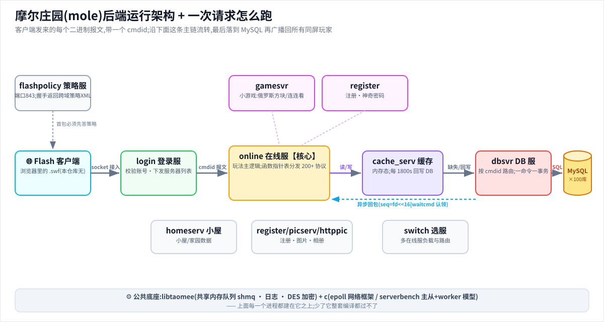
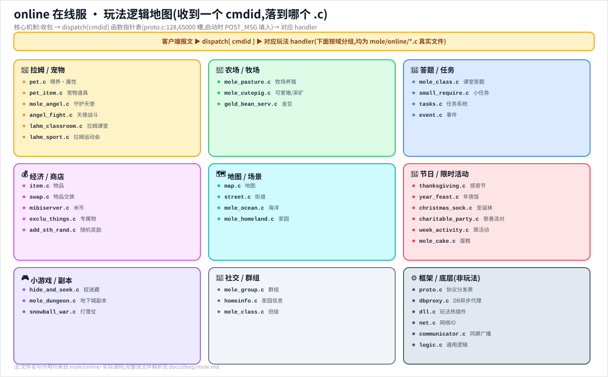
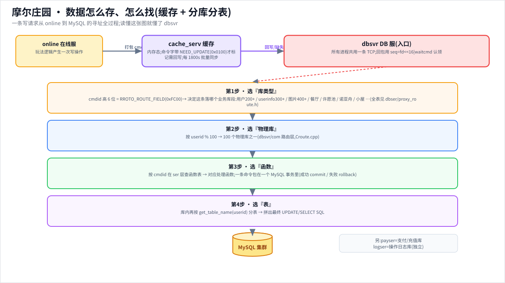
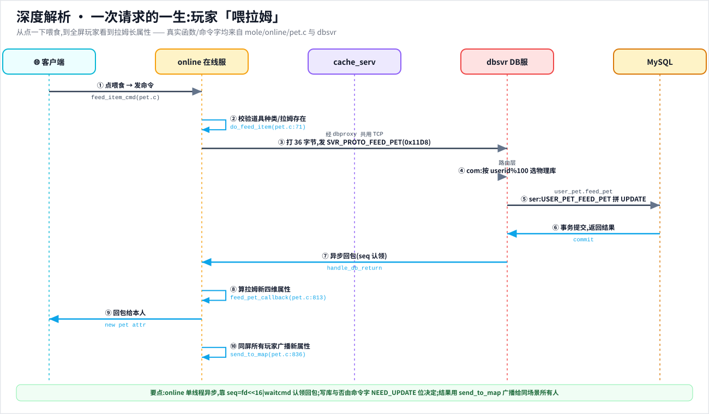

# mole 深度档案 · 每个部分实际在干什么

> 配套概览见 [../modules/mole.md](../modules/mole.md) · 协议 [../protocol.md](../protocol.md) · 内容数据 [../content-data.md](../content-data.md) · 总入口 [../../README.md](../../README.md)

本档案不重复"是什么",只讲"运行时它到底在干什么":每个进程开机后做什么、收到报文怎么走、玩法逻辑落在哪个函数、跨进程怎么对话。所有行号都是实读 grep/Read 出来的;不确定处标注"(推测)"。



**配套保姆级图解**(点开看大图;总入口 [README 摩尔庄园图解区](../../README.md#-摩尔庄园--保姆级图解从快速上手到深度解析)):

- 🧠 [思维导图](../img/mole-mindmap.svg) · 🏗️ [进程拓扑全景](../img/mole-topology.svg) · 🎮 [online 玩法地图](../img/mole-online-map.svg)
- 💾 [数据层/分库分表](../img/mole-data-layer.svg) · 🔬 [请求时序(喂拉姆)](../img/mole-request-sequence.svg) · 📦 [内容数据地图](../img/mole-content-map.svg)







---

## 一图看懂:进程拓扑与一次玩法报文的真实流向

摩尔庄园是典型的淘米"多进程 + 共享内存队列(shmq)+ UDP/TCP + 组播(mcast)"集群。每个进程都是 **父进程(PROC_MAIN)fork 出 N 个 worker(PROC_WORK)+ 若干连接进程(PROC_CONN)**,worker 之间靠 System V 共享内存队列收发报文,这是 `c`/`libtaomee` 框架(`benchapi.h`)提供的底座。

```
Flash 客户端(swf,跑在浏览器/Ruffle/touchHLE)
   │  ① 连 843 端口取跨域策略
   ▼
flashpolicy ── 回 <cross-domain-policy>,放行 *:*    [mole/flashpolicy/service.c]
   │  ② 走登录服(校验淘米账号)
   ▼
login / new_login ── 校验 md5、向 session 服/DB 验票,下发 online 列表  [mole/login/]
   │  ③ 拿着 session 连 online:1863
   ▼
┌──────────────────────────  online(玩法主进程,455 文件)  ──────────────────────────┐
│  net.c 收包 → proto.c 的 dispatch[cmd] 函数指针表 → 各 *.c 玩法 handler            │
│  · 同场景广播:communicator.c → UDP 组播 224.x:5538 → broadcaster 进程 → 同地图玩家 │
│  · 持久 读写:dbproxy.c send_request_to_db() ──TCP──▶ dbproxy(com)                  │
│  · 高频态:cache_svr.c ──▶ cache_serv(在线/宠物/家园热度,定时回写)               │
│  · 进小游戏:把玩家转交 gamesvr:3001                                               │
└──────────────────────────────────────────────────────────────────────────────────┘
   │ ④ DB 请求(server_proto_t,seq=fd<<16|waitcmd)
   ▼
dbproxy(dbsvr/com) ── 按 userid%100 选库 → 转发给 ser  [mole/dbsvr/com/src/Croute.cpp#L228]
   ▼
dbsvr/ser ── Croute_func::deal() 按 cmdid 查表 → 调 Cuser_*::xxx() → 拼 SQL → MySQL
   │ ⑤ 结果原路回 online,dbproxy.c 按 seq 找回 sprite 和 waitcmd,调对应 *_callback()
   ▼
online 把结果打回客户端 / send_to_map 广播给同屏玩家
```

辅助进程:`central_online`(跨 online 实例的全局协调,4431)、`switch`(SwitchServer 连接调度)、`homeserv`(小屋家园服)、`picserv/httppic`(玩家自定义图片)、`register`(建摩尔角色)、`ip_counter/downloadstat/errreport/school_bar`(运营辅助)。

---

## 逐部分拆解(每个进程实际职责 + 关键函数 + 跟谁通信)

### flashpolicy —— 最简单但缺它连不上
Flash 安全模型要求 socket 连接前先到目标主机 843 端口取跨域策略。本进程只做一件事:收到 23 字节的 `<policy-file-request/>` 就回一段放行所有域/所有端口的 XML。
- 核心:[mole/flashpolicy/service.c#L48](../../mole/flashpolicy/service.c#L48) `handle_process()` —— 第 57 行 `if (rcvlen == 23 && !memcmp(recvbuf, policy, 23))` 判定请求,回 [#L51](../../mole/flashpolicy/service.c#L51) 那段 `<allow-access-from domain="*" to-ports="*"/>`。
- **复活要点**:Ruffle/touchHLE 跑真 swf 时,这个 843 策略服必须存在,否则客户端连 online 前就被 Flash 安全沙箱挡死。

### login / new_login —— 鉴权 + 下发服务器列表
C++ 写的登录服,职责:校验淘米账号 md5、向 session 服务器/DB 验票、把可用 online 列表回给客户端。
- [mole/login/myinit.cpp](../../mole/login/myinit.cpp) 读 `mole_dbproxy`/`time_ip`/`master_ip` 配置;
- [mole/login/mysvrlist.cpp](../../mole/login/mysvrlist.cpp) 维护 online 服务器列表;[mole/login/mydbproxy.cpp](../../mole/login/mydbproxy.cpp) 是它到 DB 的代理;
- 真正的"进场鉴权"其实发生在 **online 内部**(见下方 `auth_cmd`),login 主要负责账号层。

### online —— 玩法主进程(本模块皇冠,下一大节专讲)
- 进程模型:`run_worker_process()`([mole/online/service.c#L489](../../mole/online/service.c#L489))启动 `worker_num`(默认 20)个虚拟 online;
- 收包入口:`handle_process()`([mole/online/service.c#L373](../../mole/online/service.c#L373))→ 连接进程走 `parse_protocol()`、worker 走 `worker_handle_net()`;
- 命令分发:全靠 `proto.c` 里一张函数指针表 `dispatch[MAX_PROC_MSG_NUM]`([mole/online/proto.c#L128](../../mole/online/proto.c#L128)),用宏 `POST_MSG(cmd, handler)` 在启动时填好([#L2050](../../mole/online/proto.c#L2050) 起 200+ 条注册)。

### cache_serv —— 高频态缓存 + 定时回写
在线态、宠物拉姆态、家园热度等"读多写多"的数据放内存,**每 `timer_step_time`(默认 1800 秒)同步一次 DB**([mole/cache_serv/doc/readme.txt](../../mole/cache_serv/doc/readme.txt) 第 3 节)。worker_num 高达 200。
- 命令字编码很有讲究([mole/cache_serv/pkg/proto.h#L25](../../mole/cache_serv/pkg/proto.h#L25)):`RROTO_ROUTE_FIELD 0xFC00`(高 6 位做路由)、`NEED_UPDATE 0x0100`([#L29](../../mole/cache_serv/pkg/proto.h#L29))标识"这是写操作、需要回写 DB"。例如 `USER_PET_SKILL_SET_CMD = (0x10EA | NEED_UPDATE)`([#L53](../../mole/cache_serv/pkg/proto.h#L53))—— 命令字本身就携带"读/写"语义,缓存层据此决定要不要打脏标记。
- **复活要点**:离线服可把这套简化成"内存态 + 退出落盘",`NEED_UPDATE` 位就是天然的脏标记设计参考。

### dbsvr —— 持久层(最大代码体,1248 文件)
分四块:`ser`(真正连 MySQL 的 DB 进程)、`com`(dbproxy 代理,做分库路由)、`logser`(日志库)、`payser`(支付库)。
- **com 分库路由**([mole/dbsvr/com/src/Croute.cpp#L228](../../mole/dbsvr/com/src/Croute.cpp#L228)):按报文里的 id(userid)取模选库 —— `ROUTE_USER: index = 200 + id%100`、`ROUTE_USERINFO: 300 + id%100`、`ROUTE_PICTURE: 400 + id%100`。即 **用户数据按 uid%100 水平分成 100 片**。
- **ser 命令路由**([mole/dbsvr/ser/src/Croute_func.cpp#L1699](../../mole/dbsvr/ser/src/Croute_func.cpp#L1699))`Croute_func::deal()`:取 `cmd_id`,在 `cmdmaplist` 哈希表里查 `PRI_STRU`(含报文长度校验 + 处理函数指针),命中就 `(this->*p_deal_fun)(...)`,顺带 `STD_OPEN_AUTOCOMMIT()`。注册用宏 `FILL_CMD_WITH_PRI_IN(CMD, func)`(带私有入参结构体)/`FILL_CMD_WITHOUT_PRI_IN`([mole/dbsvr/include/Croute_func_def.h#L30](../../mole/dbsvr/include/Croute_func_def.h#L30)),整张表从 [Croute_func.cpp#L100](../../mole/dbsvr/ser/src/Croute_func.cpp#L100) 起铺了上千条。
- **真正拼 SQL 的地方**在 `Cuser_*.cpp`,每个业务一个类:`Cuser_pet`(宠物)、`Cuser_farm_animal`(牧场动物)、`Cuser_piglet`(小猪/宠物)、`Cuser_jy`(家园)等。表名还做了**第二级分表**:`get_table_name(userid)` 按 uid 再选具体表([mole/dbsvr/ser/src/Cuser_pet.h#L51](../../mole/dbsvr/ser/src/Cuser_pet.h#L51))。
- 数值表直接读:经验→等级换算是一个 MySQL 函数 `get_grade(exp)`([mole/dbsvr/ser/sql/get_grade.sql#L1](../../mole/dbsvr/ser/sql/get_grade.sql#L1)),一长串 `elseif exp<N then return L`,复活时可整段抄成等级表。

### gamesvr —— 独立小游戏服(插件化)
online 把玩家"转交"到这里跑实时小游戏。每个小游戏一个目录,编译成模块:`kart`(卡丁车)、`pop`(扑泡球,单文件 8 万字节是最大的玩法实现)、`link_link`(连连看)、`flight_game`(飞行器)、`new_card`/`cardgame`(卡牌)、`gobang`/`chinesechess`(五子棋/象棋)、`paopaoball`、`sled`(滑沙)、`surf_riding`、`tug_of_war`/`new_tug`(拔河)、`angel_fight`(天使斗士对战)、`ocean_brave` 等([mole/gamesvr/games/](../../mole/gamesvr/games/))。
- 协议头自成一套([mole/gamesvr/proto.h#L24](../../mole/gamesvr/proto.h#L24))`protocol_t { len, ver, cmd(uint32), id, ret, body[] }`,`proto_version = 200`;
- 通用命令字:`proto_player_enter = 30001`、`proto_game_ready = 30004`、`proto_game_score = 30006`、`proto_player_action = 30010`、卡牌 `proto_new_card_get_card_info = 30019`([mole/gamesvr/proto.h#L37](../../mole/gamesvr/proto.h#L37) 起)。
- 公共框架在 `mpog.cpp/hpp`(多人在线游戏基类)、`chessgame.hpp`、`reqhandler.hpp`,各游戏继承复用。

### switch —— 连接调度网关(C++)
[mole/switch/switch.cpp#L106](../../mole/switch/switch.cpp#L106) 里有个 `switch(pkg->cmd)`,把跨服广播类报文(`dbcmd_guess_start/end`、`dbcmd_add_item`)路由到 `Online::broadcast_guess_pkt` / `Online::user_add_item_pkt`。它是 online 集群对外的统一接入/广播分发层。

### homeserv / picserv / httppic
- `homeserv`:小屋/家园服务(HomeServer),承接 online 转发的家园相关重逻辑;
- `picserv` + `httppic`:玩家自定义图片(留言板照片等)的二进制存取与 HTTP 取图,`httppic` 的 `http_processer.cpp`(5 万字节)是 HTTP 解析主体。

### register / 运营辅助
- `register`:建摩尔角色,`Cregdeal.cpp/Cregact.cpp` 是注册业务,`Cpurge_uid.cpp` 清理无效 uid;
- `ip_counter`(IP 统计)、`downloadstat`(下载统计)、`errreport`(客户端错误上报)、`school_bar`(校园吧)—— 都是轻量运营进程。

---

## online 玩法逐组拆解(按 .c 文件分门别类:实际干啥)

online 有 100+ 个 .c,按系统归类如下(每个都对应 `dispatch[]` 里若干命令字):

**移动/场景/社交基础**
- [mole/online/logic.c](../../mole/online/logic.c):最核心的玩家动作 —— `do_walk`([#L678](../../mole/online/logic.c#L678))走路、`do_action`([#L601](../../mole/online/logic.c#L601))做表情动作、`do_talk`([#L1036](../../mole/online/logic.c#L1036))聊天、`do_enter_map`([#L392](../../mole/online/logic.c#L392))进场景、`do_buy_item`([#L40](../../mole/online/logic.c#L40))买东西、`do_throw_item`([#L1098](../../mole/online/logic.c#L1098))扔道具、好友邀请 `do_invite_friend`([#L723](../../mole/online/logic.c#L723))。
- `map.c`/`mcast.c`/`communicator.c`:场景管理 + 组播广播。`send_to_map`([mole/online/map.c#L646](../../mole/online/map.c#L646))把一条报文发给同地图所有人;真正出网走 `send_to_broadcaster`([mole/online/communicator.c#L60](../../mole/online/communicator.c#L60))UDP 组播到 `224.x:5538`。
- `item.c`/`market.c`/`swap.c`/`small_require.c`:道具背包、商城、交换、各种"小需求"任务。

**宠物拉姆(摩尔的精灵)**
- [mole/online/pet.c](../../mole/online/pet.c)(10 万字节):拉姆全生命周期 —— 买 `do_buy_pet`([#L1071](../../mole/online/pet.c#L1071))、喂 `do_feed_item`([#L1103](../../mole/online/pet.c#L1103))、玩 `do_play_with_pet`、跟随 `do_follow_pet`([#L1151](../../mole/online/pet.c#L1151))、改名/改色、属性衰减 `calc_pet_attr_full`([#L215](../../mole/online/pet.c#L215))。拉姆有饥饿/口渴/卫生/精神四维属性(hungry/thirsty/sanitary/spirit)。
- `lamu_skill.c`:拉姆技能学习;`pet_item.c`:拉姆装扮;`angry_lahm.c`/`super_guider.c`:愤怒拉姆/超级拉姆等进阶形态。
- 拉姆任务体系:`tasks.c` + pet.c 里 `do_pick_pet_task`/`do_terminate_pet_task`(派拉姆出去做任务,定时返还奖励)。

**拉姆课堂 / 答题(养成 + 知识)**
- [mole/online/lahm_classroom.c](../../mole/online/lahm_classroom.c)(8 万字节):拉姆课堂答题养成,配 `conf/class_questions.xml` 题库(协议文档 [mole/online/doc/LahmClassroomOnline协议.doc](../../mole/online/doc/LahmClassroomOnline协议.doc) 是全模块最大的设计文档,46 万字节)。
- `mole_question.c`/`tv_question.c`/`mole_class.c`/`advanced_class.c`:各类答题/课堂玩法,配 `conf/questions.xml`、`tv_question.xml`、`lahm_lessons.xml`。
- `lahm_diary.c`/`lahm_sport.c`:拉姆日记、拉姆运动会。

**牧场 / 钓鱼**
- [mole/online/mole_pasture.c](../../mole/online/mole_pasture.c)(5.8 万字节)+ `pasture.c`:牧场系统 —— 捕动物 `pasture_capture_animal_cmd`([mole/online/mole_pasture.c#L218](../../mole/online/mole_pasture.c#L218))、加饲料 `pasture_add_feed_cmd`([#L283](../../mole/online/mole_pasture.c#L283))、放牧 `herd`、加水、捞鱼 `pasture_get_animal_cmd`、围观他人牧场。鱼塘有锁(`fish_lock`)、孵蛋(`egg_count`)等状态。

**天使斗士(摩尔对战,卡牌+回合制)**
- [mole/online/angel_fight.c](../../mole/online/angel_fight.c)(10.9 万字节)+ `mole_angel.c`(9.1 万字节)+ `fight_prize.c`:天使斗士战斗系统。角色基础属性可被**装备**和**技能**加成 —— `add_base_attr_from_equip`([mole/online/angel_fight.c#L42](../../mole/online/angel_fight.c#L42))、`add_base_attr_from_type`([#L21](../../mole/online/angel_fight.c#L21));技能等级最高 10 级,从 `af_skills.xml` 读 `skill_level[lvl-1].add_val[]`([#L153](../../mole/online/angel_fight.c#L153))。实时对战本体在 gamesvr 的 `games/angel_fight/`,online 这边管养成/卡组/奖励。配套数据:`conf/af_skills.xml`(技能)、`af_prize.xml`(奖励)、`af_task.xml`、`angel_compose.xml`(合成)。

**小屋 / 家园 / 种植**
- `mole_homeland.c`/`homeinfo.c`/`homeserv` 转发:小屋装修、家园热度投票 `vote_home_flower_mud`、邻居系统、留言板审核;种植系统 `homeland_plant`/`homeland_water_plant`/`homeland_kill_bug`/`pick_fruit`(浇水、除虫、采果)、毛毛树 `get_maomao_tree_info`。

**节日 / 活动(海量)**
- 每个节日一个 .c:`christmas_sock.c`/`chris_cake.c`(圣诞)、`moon_cake.c`(中秋)、`spring.c`/`spring_couplets.c`/`year_feast.c`(春节)、`hallowmas.c`(万圣)、`thanksgiving.c`(感恩节)、`birthday.c`(生日)、`lanterns_day.c`(元宵)、`flower_party.c`、`snowball_war.c`(打雪仗)、`winter_vs_spring.c`、`fire_cup.c`、`final_boss_2011.c`、`week_activity.c`(7.4 万字节,周常活动)。这些都是限时玩法,靠 `events.xml`/`exclu_things.xml` 配置开关。

**其它系统**
- 好友/黑名单:logic.c + proto.c 里 `add_friend_cmd`/`del_friend_cmd`/`add_blacklist_cmd`;摩尔群组 `mole_group.c`(`create_molegroup`/`chat_in_molegroup`)。
- 经济:`mole_bank.c`(银行)、`mibiserver.c`(米币)、`gold_bean_serv.c`(金豆商城)、`mole_card.c`(点卡/魔法密码 `magic_code.c`)。
- 邮件/明信片:`mail.c`、`message.c`、`im_message.c`、`mole_messenger.c`。
- 许愿池 `wish_pool.c`、投票 `poll.c`、抽奖 `lucky_lottery.c`、随机道具 `rand_itm.c`/`add_sth_rand.c`、挖宝(`DigTreasureElement.xml`)。
- 职业打工:`profession_work.c`/`mole_work.c`(摩尔豆/工资 `get_smc_salary`)。

---

## 关键机制实战(讲清它怎么跑)

### 机制 1:online 的命令分发表(函数指针 + 注册宏)
online 不用大 switch,而是一张函数指针数组 `dispatcher_t dispatch[MAX_PROC_MSG_NUM]`([mole/online/proto.c#L128](../../mole/online/proto.c#L128)),签名是 `int (*)(sprite_t*, const uint8_t* body, int len)`([#L126](../../mole/online/proto.c#L126))。启动时一条条 `POST_MSG(cmd, handler)` 填表([#L2050](../../mole/online/proto.c#L2050)):宏先检查该槽位是否已占(`if (dispatch[n]) return -1`,防重复注册),再写入。例如:
```
POST_MSG(PROTO_LOGIN,        auth_cmd);     // 201 → 登录鉴权
POST_MSG(PROTO_TALK,         talk_cmd);     // 302 → 聊天
POST_MSG(PROTO_WALK,         walk_cmd);     // 303 → 走路
POST_MSG(PROTO_FEED_ITEM_USE,feed_item_cmd);// 505 → 喂拉姆
POST_MSG(PROTO_GET_PASTURE,  get_pasture_cmd);//1361→ 看牧场
```
(命令字数值见 [mole/online/proto.h#L550](../../mole/online/proto.h#L550)、[#L606](../../mole/online/proto.h#L606)、[#L668](../../mole/online/proto.h#L668)、[#L1007](../../mole/online/proto.h#L1007))。收包后直接 `dispatch[cmd](p, body, len)`,O(1) 分发。

### 机制 2:online↔DB 的异步回调(seq 复用一根 TCP)
online 所有进程共用**一条到 dbproxy 的 TCP**,请求是异步的 —— 发出去不阻塞,DB 回来再回调。怎么知道这个回包属于哪个玩家、哪条业务?靠 `server_proto_t.seq` 编码:
- 发请求 [mole/online/dbproxy.c#L599](../../mole/online/dbproxy.c#L599):`pkg->seq = (sprite_fd(p) << 16) | p->waitcmd;` —— 高 16 位是玩家连接 fd,低 16 位是当前等待的客户端命令字。
- 回包时按 `seq` 反查出 `sprite_t*` 和原始 waitcmd,再走一张 DB 回调表分发:`DO_MESSAGE(SVR_PROTO_xxx, xxx_callback)`([mole/online/dbproxy.c#L4276](../../mole/online/dbproxy.c#L4276) 起,共 **776 条**注册),如 `DO_MESSAGE(SVR_PROTO_FEED_PET, set_pet_arg_callback)`([#L4326](../../mole/online/dbproxy.c#L4326))。
- 另有一张"跨服/中心服"回调表 `DO_MESSAGE(COCMD_xxx, ...)`([#L3364](../../mole/online/dbproxy.c#L3364)),处理踢人/全服广播/跨服聊天等。
- 还有超时保护:发请求时挂 `db_return_expired` 定时器([#L589](../../mole/online/dbproxy.c#L589)),5 秒没回就报 `ERR_system_error`,避免玩家卡死。

### 机制 3:DB 两级路由 + 两级分表
1. **进程级分库**(com):`Croute::get_db_index()` 按 `userid%100` 把用户散到 100 个库实例([mole/dbsvr/com/src/Croute.cpp#L228](../../mole/dbsvr/com/src/Croute.cpp#L228)),不同业务用不同基址段(用户 200+、userinfo 300+、图片 400+)。
2. **命令级路由**(ser):`Croute_func::deal()` 按 cmdid 查哈希表调处理函数([mole/dbsvr/ser/src/Croute_func.cpp#L1699](../../mole/dbsvr/ser/src/Croute_func.cpp#L1699))。
3. **表级分表**(ser):同一个库里,`get_table_name(userid)` 再按 uid 选具体表(如宠物表)([mole/dbsvr/ser/src/Cuser_pet.h#L51](../../mole/dbsvr/ser/src/Cuser_pet.h#L51))。SQL 是 `sprintf` 到 `this->sqlstr` 直接拼([Cuser_pet.cpp#L342](../../mole/dbsvr/ser/src/Cuser_pet.cpp#L342)),写库前对数值 `get_valid_value(v, 0, ATTR_VALUE_MAX)` 做服务端钳制([#L337](../../mole/dbsvr/ser/src/Cuser_pet.cpp#L337))—— 防止客户端伪造超界属性。

---

## 端到端调用流举例:玩家"喂拉姆"从点击到落库

挑"喂拉姆一口食物"这条真实玩法,完整追一遍:

1. **客户端发包**:Flash 发 `PROTO_FEED_ITEM_USE`(cmd=505,[mole/online/proto.h#L668](../../mole/online/proto.h#L668)),body 带 `uid + petid + itemid`。
2. **online 分发**:`dispatch[505]` → `feed_item_cmd`([mole/online/pet.c#L1462](../../mole/online/pet.c#L1462)),解出三个 id 后调 `do_feed_item`([#L1103](../../mole/online/pet.c#L1103))。
3. **服务端校验**:`do_feed_item` 先查道具属性 `get_item_prop(itemid)` 且必须是 `FEED_ITEM_KIND`([#L1109](../../mole/online/pet.c#L1109)),否则报错;查拉姆存在 `get_pet(uid, petid)`([#L1112](../../mole/online/pet.c#L1112));把 `item* / petid / uid` 暂存进 `p->session`([#L1123](../../mole/online/pet.c#L1123))以备回调用;若食物可治病/复活就清病/死状态([#L1128](../../mole/online/pet.c#L1128))。
4. **发 DB 请求**:调 `db_feed_pet`([#L2282](../../mole/online/pet.c#L2282)),把 `petid/flag/sicktime/stamp/hungry/thirsty/sanitary/spirit/selfid` 打成 36 字节,`send_request_to_db(SVR_PROTO_FEED_PET=0x11D8, p, 36, buff, uid)`([pet.h#L34](../../mole/online/pet.h#L34))。`send_request_to_db`([dbproxy.c#L559](../../mole/online/dbproxy.c#L559))填 `server_proto_t`,`seq=fd<<16|505`,TCP 发给 dbproxy。
5. **dbproxy 选库**:com 按 `uid%100`([Croute.cpp#L228](../../mole/dbsvr/com/src/Croute.cpp#L228))转给对应 ser。
6. **ser 路由 + 执行**:`Croute_func::deal()` 查到 `FILL_CMD_WITH_PRI_IN(USER_PET_FEED_PET, user_pet_feed_pet)`([Croute_func.cpp#L454](../../mole/dbsvr/ser/src/Croute_func.cpp#L454)),调 `Croute_func::user_pet_feed_pet`([#L7387](../../mole/dbsvr/ser/src/Croute_func.cpp#L7387)),内部 `this->user_pet.feed_pet(userid, p_in)`([#L7400](../../mole/dbsvr/ser/src/Croute_func.cpp#L7400))→ `Cuser_pet::set_comm` 系列拼出 `update <分表> set hungry=.. thirsty=.. ... where userid=.. and petid=..`([Cuser_pet.cpp#L342](../../mole/dbsvr/ser/src/Cuser_pet.cpp#L342)),数值先 `get_valid_value` 钳制,执行 MySQL,提交。喂食还会顺带在家园访客列表打标 `jy_accesslist_set_opt(... FEED_PET_OPT_FLAG)`([Croute_func.cpp#L7409](../../mole/dbsvr/ser/src/Croute_func.cpp#L7409))。
7. **回包回调**:结果原路回 online,`dbproxy.c` 按 `dbpkg->cmd==SVR_PROTO_FEED_PET` 命中 `DO_MESSAGE(SVR_PROTO_FEED_PET, set_pet_arg_callback)`([dbproxy.c#L4326](../../mole/online/dbproxy.c#L4326)),用 `seq` 还原出 `sprite_t*`。
8. **广播结果**:最终 `feed_pet_callback`([pet.c#L813](../../mole/online/pet.c#L813))从 `p->session` 取回 item/pet,打 `PROTO_FEED_ITEM_USE` 回包,装上拉姆新的四维属性 hungry/thirsty/sanitary/spirit,`send_to_map(p, msg, ...)`([#L836](../../mole/online/pet.c#L836))广播给同场景所有玩家 —— 于是别人也能看到你的拉姆被喂了。

> 同样的模式适用于换装(`use_body_item_cmd`→`SVR_PROTO_PUT_ON_CLOTHES`)、答题、钓鱼(`pasture_get_animal_cmd`)等所有玩法:**online 校验 → seq 异步发 DB → dbproxy 分库 → ser 拼 SQL 落 MySQL → callback → send_to_map 广播**。

---

## 复活实操提示(对 moleworld 复活)

**能直接拿来用的:**
- **协议契约**:`dispatch[]` 注册表([proto.c#L2050](../../mole/online/proto.c#L2050) 起)就是客户端能发的所有命令字清单,加上 [proto.h](../../mole/online/proto.h) 的数值定义,等于一份完整的"客户端能干什么"协议字典 —— 真 swf 写死了这些 cmd,服务端必须 1:1 复刻。
- **数值/内容**:`conf/items.xml`(全道具)、`af_skills.xml`(技能加成公式)、`class_questions.xml`(题库)、`get_grade.sql`(等级表)直接导。
- **服务端校验规则**:数值钳制 `get_valid_value(v,0,MAX)`、道具种类校验、宠物存在性校验等,照搬就能防作弊。
- **flashpolicy 那段 XML**:跑真 Flash 客户端必备,原样复用。

**要自己补/可简化的:**
- **多进程+组播+共享内存**这套是为千万并发设计的,离线/小规模复活**不必照搬** —— 可以合并成单进程,把"online↔dbproxy↔ser"三段折叠成一个进程内直连 SQLite/MySQL;`seq=fd<<16|cmd` 的异步回调可改成同步调用。
- **cache_serv 的 NEED_UPDATE + 定时回写**:简化为内存态 + 退出落盘,但 `0x0100` 脏标记位的设计思路值得保留。
- **分库分表(uid%100 + get_table_name)**:小规模复活直接单库单表,忽略路由层即可,但要知道泄漏源码里同一玩家数据是散在多片的(逆向建表结构时别被表名后缀迷惑)。
- **gamesvr 实时小游戏**:每个游戏是独立模块,复活时可按优先级逐个移植(连连看/泡泡等核心先做),不必一次全上。

---

回总入口:[../../README.md](../../README.md)
